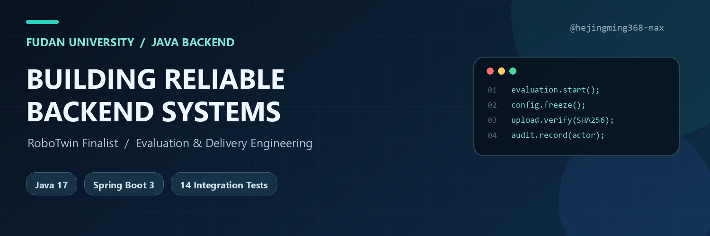

## 复旦大学本科在读｜Java 后端开发

我关注如何把复杂流程做成**可运行、可验证、可追踪的后端系统**。目前的工程实践来自 RoboTwin 具身智能比赛，以及围绕评测、交付和性能分析独立实现的三个 Java 项目。

**English:** Fudan undergraduate building reliable Java backend systems and developer tools for evaluation orchestration, regression analysis, and HTTP performance testing.

## 项目一：RoboTwin Evaluation Platform

[查看项目 → robotwin-evaluation-platform](https://github.com/jimi-21/robotwin-evaluation-platform)

基于真实比赛中的评测与交付流程，使用 Java 17 / Spring Boot 3 独立实现的后端系统，包含可直接操作的 Web 控制台。

- **评测编排**：任务状态机、不可变配置快照、异步逐场落库、失败重试。
- **结果审计**：支持真实 `score_audit.json` 导入，保存计分快照并重新计算汇总指标。
- **可靠上传**：乱序分片、断点续传、分片幂等、数据库行锁和 SHA256 合并校验。
- **安全与集成**：JWT 角色权限、可配置 RoboTwin HTTP Runner 适配器、OpenAPI 文档。
- **可视化演示**：登录、一键评测、episode 查看、浏览器分片上传与验证后下载。

`Java 17` `Spring Boot 3` `Spring Security` `MySQL / H2` `Flyway` `JUnit / MockMvc` `Docker`

**验证结果：**15 个集成测试；真实 JAR 和浏览器端到端演示均已跑通。

## 项目二：eval-diff

[查看项目 → eval-diff](https://github.com/jimi-21/eval-diff)

用于比较两次模型评测的 Java CLI，避免只看总分而忽略具体场景退化。

- 校验 episode 和 seed 是否一一对应，保证比较公平。
- 识别成功恢复、成功变失败、步数增加和减少。
- 输出控制台、JSON 和无依赖 HTML 报告。
- 通过退出码支持 CI 模型发布门禁。

真实本地样例中，工具识别出 `84.1 → 79.7`、成功率 `0.8 → 0.6`，并定位到 seed 4 的 `SUCCESS → FAILURE`，没有仅用平均步数得出“模型更快所以更好”的错误结论。

`Java 17` `Jackson` `JUnit 6` `CLI` `CI Quality Gate` · **5 个自动化测试**

## 项目三：latency-lab

[查看项目 → latency-lab](https://github.com/jimi-21/latency-lab)

纯 Java 并发 HTTP 压测工具，可以直接用于检验上面的 Spring Boot 服务。

- 固定线程池控制并发，调度器实现 RPS 限速。
- 记录状态码、异常、响应大小和纳秒级请求耗时。
- 统计吞吐量、成功率及 P50/P90/P95/P99 延迟。
- 输出控制台、JSON、逐请求 CSV 和 HTML 性能报告。

在本地真实演示中，50 个请求以并发 5、目标 50 RPS 执行，工具准确识别了 45 次成功和 5 次故意构造的 503，并生成延迟分布报告。

`Java 17` `HttpClient` `Concurrency` `Performance Analysis` · **5 个自动化测试**

## 上游 Java 开源贡献

- **Hutool 生产代码修复**：[#4360](https://github.com/chinabugotech/hutool/pull/4360) 与 [#4366](https://github.com/chinabugotech/hutool/pull/4366) 已合并，处理不同 Locale 下的 Getter/Setter 判断和 Bean 属性大小写匹配问题。
- **RxJava 测试工程**：32 个测试改进 PR 已获维护者合并，主要处理并发测试隔离和不确定性，例如 [#8377](https://github.com/ReactiveX/RxJava/pull/8377) 将依赖墙钟时间的断言改为确定性验证。

这些贡献都经过上游维护者审核；测试稳定性工作不包装成生产功能开发，原创项目与 Fork 贡献工作区也分别展示。

## 比赛工程经历：RoboTwin 具身智能比赛

独立负责初赛的数据处理、模型训练、HTTP 推理服务、评测审计、问题排查及官方材料提交，项目晋级决赛。

这段经历让我接触到的不只是模型训练，还包括数据契约、配置隔离、固定场景评测、失败证据留存，以及 GB 级提交文件的完整性核验。原始比赛工程以 Python 为主，上面的 Java 项目是后续独立实现的工程化成果，两者不混淆技术栈。

## 工程证据与开发方式

- **三个项目合计 25 个自动化测试**，并为每个项目配置 GitHub Actions。
- 不只展示源码，还提供一键演示、真实样例、HTML 报告和浏览器截图。
- **可运行优先**：先完成真实调用链，再讨论更复杂的架构。
- **证据优先**：代码、测试、日志和演示比“高并发”“生产级”等标签更重要。
- **诚实标注边界**：本地实验、合成演示、契约测试和真实环境联调分别说明。

目前继续完善 Java 后端工程能力，连接真实 RoboTwin Runner，并探索对象存储与更完善的任务执行机制。欢迎交流 Java 后端、小型工程需求及具身智能工程化。
